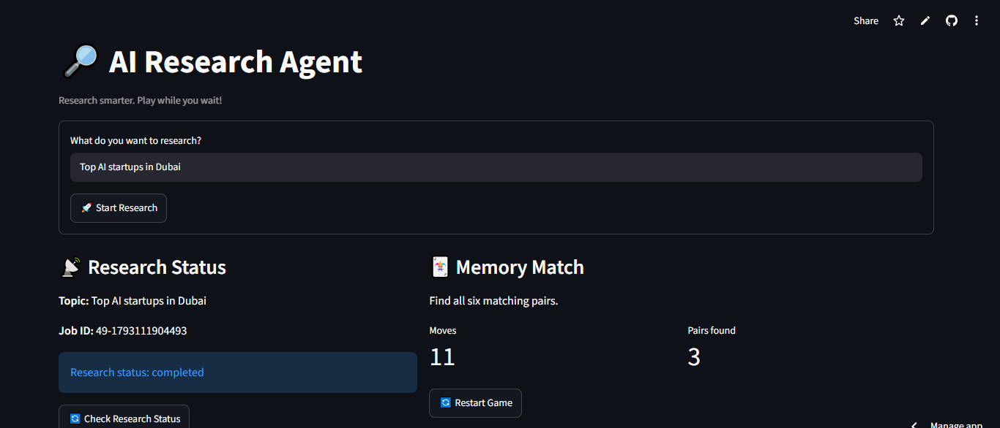

🔎 AI Research Agent

An AI-powered research application built with n8n, Streamlit, and Tavily. It automates research on user-provided topics, generates structured reports, and includes a fun Memory Match game while users wait.

 🚀 Features

- AI-Powered Research: Enter any topic and start automated research.
- Automated Workflow: n8n coordinates research, information extraction, organization, and report generation.
- Live Status Tracking: Track research using a unique Job ID.
- Structured Reports: View generated research reports directly in Streamlit.
- Memory Match Game: Play an interactive card-matching game during research.
- Secure API Integration: Backend webhooks use API key authentication.
- Cloud Deployment: Frontend hosted on Streamlit Community Cloud.

📸 Application Screenshot



🛠️ Tech Stack

| Technology | Purpose |
|---|---|
| Python | Application development |
| Streamlit | Interactive frontend |
| n8n | Workflow automation and backend |
| Tavily | Web research |
| AI Models | Research organization and report generation |
| GitHub | Source code and portfolio |
| Streamlit Community Cloud | Application hosting |

⚙️ How It Works

1. The user enters a research topic in the Streamlit app.
2. Streamlit sends a request to the n8n research workflow.
3. n8n generates a unique Job ID and starts research.
4. Research agents gather and organize information.
5. An AI-generated report is saved by the backend.
6. Streamlit checks the research status and displays the completed report.
7. Meanwhile, the user can play the Memory Match game.

 🏗️ Architecture

User → Streamlit Frontend → n8n Webhook → AI Research Workflow → Report Storage → Status API → Streamlit Report

 🔐 Security

- API keys are stored using Streamlit Secrets.
- Backend webhooks require authentication headers.
- Sensitive credentials are excluded from the public repository.

 ▶️ Run Locally

Install dependencies:

```bash
pip install -r requirements.txt
```

Create a `.streamlit/secrets.toml` file containing your own backend API key:

```toml
RESEARCH_API_KEY = "YOUR_API_KEY"
```

Update the webhook URLs in `app.py` to point to your own n8n workflows.

Start the application:

```bash
streamlit run app.py
```

 🌐 Live Demo

Live Application: [Launch AI Research Agent](https://ai-research-agent-ahmar.streamlit.app/)

> Note: AI research functionality depends on the availability of the n8n backend. If the backend is inactive, the research feature may be unavailable.

👨‍💻 Project Highlights

This project demonstrates practical experience with:

- AI agent workflow orchestration
- API integration and authentication
- Asynchronous research job tracking
- Python frontend development
- Cloud deployment
- Interactive application design

 📌 Future Improvements

- Automatic research status refresh
- Downloadable PDF research reports
- Research history dashboard
- Improved user access controls and rate limiting
- Enhanced report formatting


Built as a hands-on AI automation and application development project.
